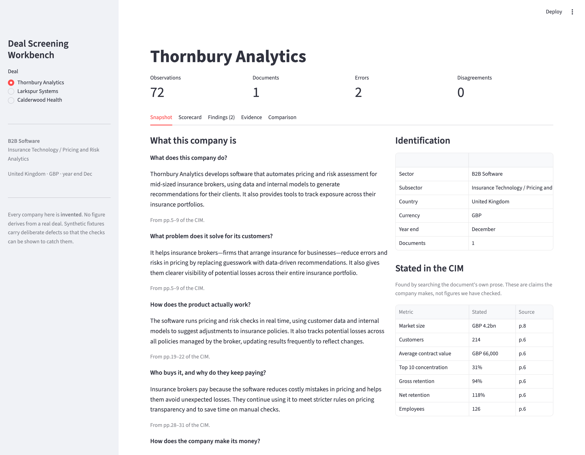
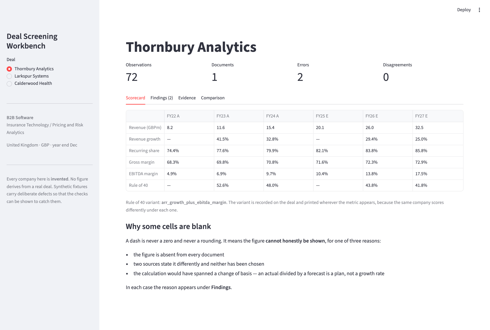
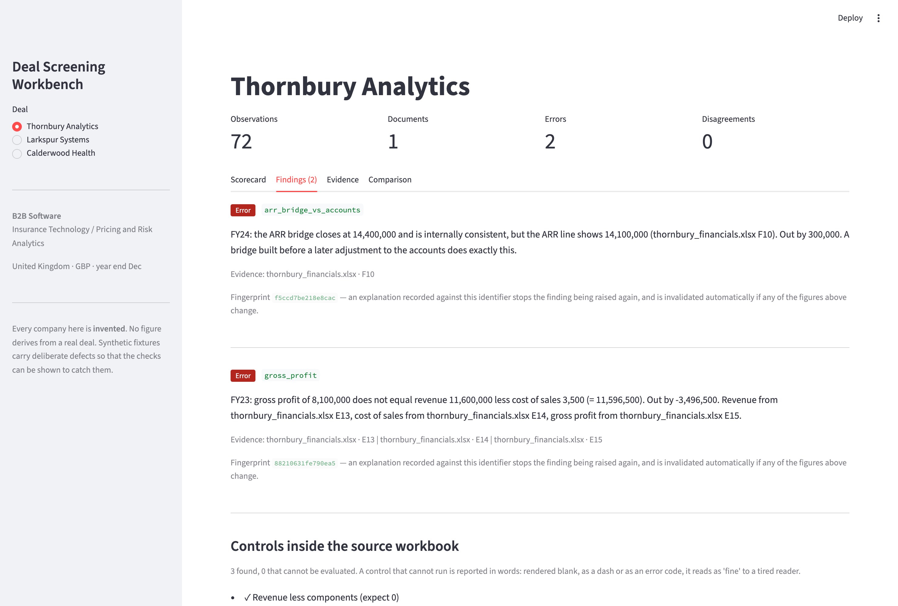
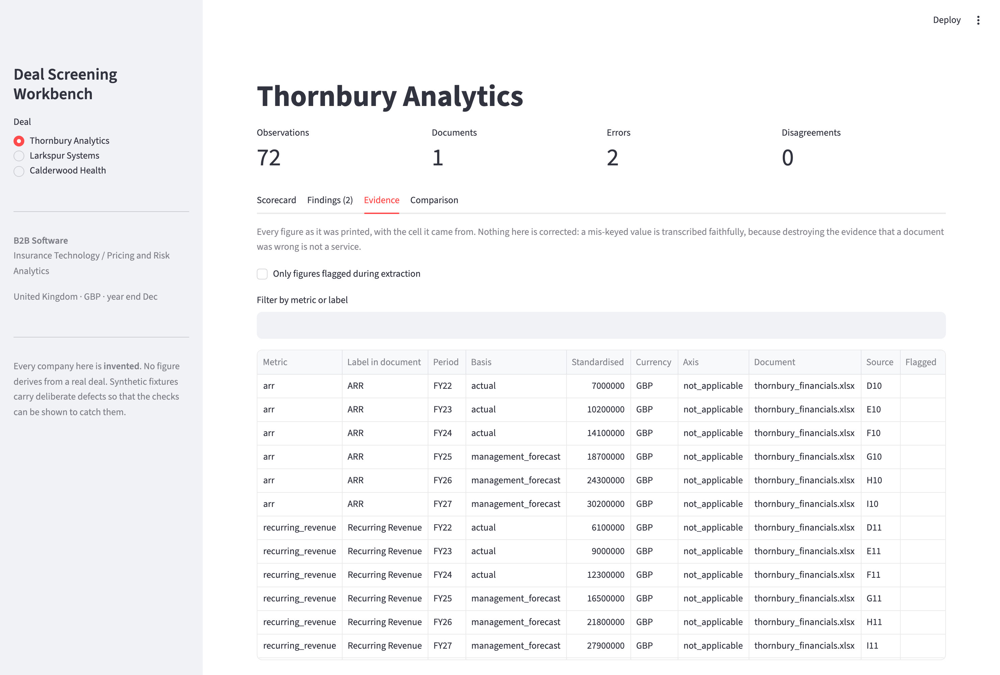
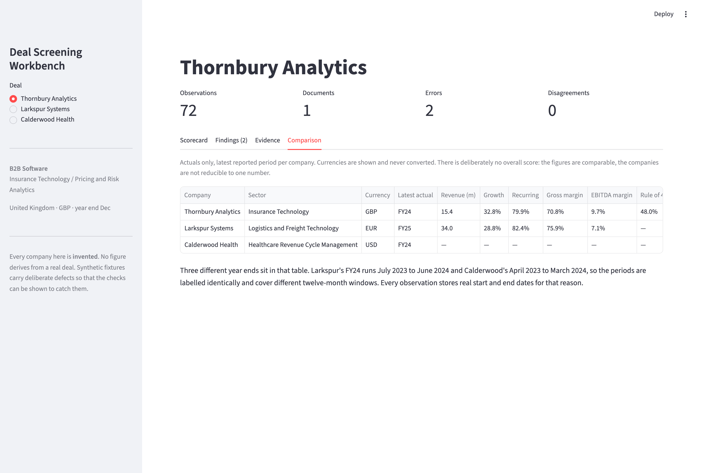

# Deal Screening Workbench

[](https://github.com/AdrienDalais/Deal-screening/actions/workflows/tests.yml)

Turning company documents into a financial scorecard that shows its
working — built by a growth-equity investor to run a real screening
workflow, and to be defensible line by line.



---

## The idea

The database is **not a spreadsheet of company financials**. It is a
**ledger of observations**.

A spreadsheet says:

> Revenue for FY23 is £12.4m.

This system says:

> An LLM reading page 14 of the CIM saw a line labelled "Turnover" with
> the value 12.4, in a table headed "£m", covering the year ended 31
> December 2023, presented as an actual. It has not yet been reviewed by
> a human.

That length is the product. Every problem that actually bites in deal
screening — a figure re-keyed at the wrong scale, a forecast smuggled
into a historical table, two documents that disagree — is invisible in
the first version and obvious in the second.

Two rules follow, and they drive nearly every design decision:

**Rows are never overwritten.** A correction writes a new record and
marks the old one superseded. The original extraction stays, because it
is the evidence of what the document said — and because it is the only
data there is for measuring whether extraction works.

**Disagreement is stored, not resolved.** Two documents claiming
different FY24 revenue produce two live rows. `financial_observations`
deliberately carries *no* uniqueness constraint on (deal, metric,
period), because a unique constraint would force the system to silently
pick one.

---

## What it does

### It explains the company in plain language, and never invents a number

The briefing on the left is written by a model from the CIM pages cited
beneath each answer. Every number on the page is read from a document
and carries its page or cell.

**A summary containing a figure is rejected outright.** That is enforced
in code, not requested in the prompt — a plausible invented number is
the one failure of an LLM summary that a reader cannot catch, so it is
made impossible rather than managed. Checking for digits was not enough:
"every two weeks" and "three-year contracts" got through, so quantities
spelled out are rejected too.



### It refuses to show a figure it cannot defend



A dash in the scorecard is never a zero and never a rounding. It means
the figure cannot honestly be shown, and the reason is always in
**Findings**:

- the figure is absent from every document
- two sources state it differently and neither has been chosen
- the calculation would have spanned a change of basis — an actual
  divided by a forecast is a plan, not a growth rate

Showing the figure with a warning icon was considered and rejected. The
number gets read; the icon does not; and by the time it reaches a paper
the caveat is gone.

### It transcribes, and never corrects



Every figure is stored as it was printed, with the cell or page it came
from. A cost of sales cell holding `3.5` in a sheet denominated in
thousands is extracted as `3.5` — understated by a factor of 1,000, and
reported as such by reconciliation.

**Extraction and reconciliation carry separate accuracy scores**, and
conflating them would make both meaningless. An extractor that
"helpfully" repairs a figure destroys the evidence that the document was
wrong, which on a real deal is often the most valuable thing you have
found.

### It compares deals without pretending they are the same



Three currencies and three fiscal year ends sit in that table. Larkspur's
FY24 runs July 2023 to June 2024; Calderwood's April 2023 to March 2024.
The labels are identical and the windows are not, which is why every
observation stores real start and end dates.

There is deliberately **no overall score**. The figures are comparable;
the companies are not reducible to one number.

---

## Running it

Requires Python 3.12.

```bash
python3.12 -m venv .venv
source .venv/bin/activate
pip install -r requirements.lock.txt
streamlit run app/main.py
```

Opens at `http://localhost:8501` with three synthetic companies loaded.

Without the interface:

```bash
python -m tools.run_deal              # all three
python -m tools.run_deal larkspur     # one
pytest tests/ -q                      # the test suite
```

---

## The synthetic companies

Three invented companies, each with a CIM and a financials workbook, each
carrying **deliberate defects**. They are also the evaluation set.

| | Currency / year end | Defects planted |
|---|---|---|
| **Thornbury Analytics** | GBP, December | A cost of sales cell re-keyed at the wrong scale · an ARR bridge that ties to itself but not to the accounts · adjusted EBITDA printed as plain "EBITDA" |
| **Larkspur Systems** | EUR, **June** | A merged "Historicals" header spanning one column too far, so a forecast sits inside the actuals · a Rule of 40 labelled for CARR on a company that reports no CARR |
| **Calderwood Health** | USD, **March** | Management accounts restating FY24 revenue from 31.8 to 30.9 · operating costs presented on two overlapping breakdowns · a check formula that cannot be evaluated |

**The documents and the answer key are generated from one source.** Had
the documents been written by hand, the "correct" answer would be
whatever someone remembered putting in them, and the key would drift
every time a fixture changed. Generated together, it is correct by
construction — and CI proves a rebuild produces byte-identical files.

The CIM fixture is an 84-page landscape slide deck, because that is what
a CIM actually is. It was calibrated against the structure of a real one,
measured with `tools/inspect_pdf.py`, which reports page geometry, text
density and image statistics and **nothing else** — so a confidential
document can be characterised without any part of it being disclosed.

| | Real IM | Fixture |
|---|---|---|
| pages | 84 | 84 |
| median characters per page | 1,156 | 1,006 |
| reading-order disorder | 18% | 17% |
| pages with no text at all | 1 | 1 |

Reading-order disorder matters most: PowerPoint writes text boxes in
creation order, not reading order, so extracted text arrives as scattered
fragments. A fixture drawn tidily top-to-bottom would let us build an
extractor that quietly depends on reading order and then fails on every
real document.

---

## What is built, and what is not

| | |
|---|---|
| Schema and storage — 11 tables, Alembic migrations | **Done** |
| Synthetic fixtures — 3 companies, 9 planted defects, answer keys | **Done** |
| Calculations — growth, CAGR, margins, Rule of 40 variants | **Done** |
| Extraction from spreadsheets — scores 100% against the answer key | **Done** |
| Reconciliation — 10 checks, catches all 9 planted defects | **Done** |
| Review interface | **Done** |
| Extraction from PDFs via an LLM | Not started |
| Scorecard export to Excel · onboarding paper to Word | Not started |
| Screening decision and information-request list | Not started |

`llm/`, `retrieval/` and `reports/` are empty packages reserving the
structure for that work. The LLM path has a deliberate constraint already
enforced by the database: a deal marked `confidential` cannot be recorded
against a hosted provider — a CHECK constraint rejects the row, so a bug
in the application cannot produce one.

---

## Design decisions worth reading

Every architectural decision is in [`docs/DECISIONS.md`](docs/DECISIONS.md)
with its date, its reason, and the alternative that was rejected. A few:

**Standardisation is scale only. Currency is never converted.**
`value_standardised` is the figure in whole units of the *original*
currency. An FX rate baked into a stored number is a hidden assumption
with no date attached.

**Issues are computed; resolutions are stored.** Reconciliation findings
are never persisted, because a stored issue can disagree with the data it
describes. The analyst's *explanation* is stored, keyed by a fingerprint
of the figures involved — so a legitimate restatement is explained once,
and the explanation is invalidated automatically if any figure changes.

**Rule of 40 has named variants, set per deal.** Thornbury FY24 scores
0.4798 on the ARR variant and 0.4250 on sales. Same company, same year,
five points apart. The variant is recorded on the deal and printed
wherever the metric appears, and a label naming an input the company does
not report is a hard error.

---

## Testing

179 tests. The one worth pointing at is
[`tests/test_defects_caught.py`](tests/test_defects_caught.py): it runs
the real pipeline over the fixtures as they sit on disk and asserts that
each declared defect produces a finding.

It was written after **every unit test passed while two of nine defects
produced no finding at all.** The checks had been tested against data
built to suit them; the data they actually receive comes from a module
that was silently dropping a field. Both failures were at the seams
between modules rather than inside them.

That episode is written up in
[`docs/INTERVIEW_NOTES.md`](docs/INTERVIEW_NOTES.md), along with two
occasions where a measuring instrument produced confident, meaningless
numbers until it was tested against an input whose answer was already
known.

---

## Confidentiality

- No real deal document has ever been committed. `.gitignore` was written
  before the first `git add`, listing `.env`, `data/` and
  `deals_private/`.
- Every company, figure, name and source reference in this repository is
  invented.
- Deals are classified `synthetic`, `public` or `confidential`, and the
  default for an unclassified deal is `confidential` — the forgetful case
  is the safe case.

## Built with

Python 3.12 · SQLAlchemy · Alembic · Pydantic · openpyxl · pypdf ·
reportlab · Streamlit · pytest

Developed with [Claude Code](https://claude.com/claude-code). Where that
assistance went further than originally intended, it is recorded in
[`docs/DECISIONS.md`](docs/DECISIONS.md) #012 rather than left implicit.
